  

  
  
  
  
  
  

# ⚡ Awesome Visual Workflow Automation 🔄

> 🌟 **A comprehensive, SEO-optimized curated directory of top Visual Workflow Automation platforms, low-code iPaaS solutions, and open-source DAG/event-driven orchestration engines.** Spanning industry-leading commercial cloud suites and community-driven, self-hostable tools for building intelligent integrations, AI agent pipelines, and automated business processes on an intuitive visual canvas.  
> ⭐ *Star this repository if you find it valuable for your automation architecture!* ⭐

---

## 📑 Table of Contents

- [🌐 Sector Overview & Market Dynamics](#-sector-overview--market-dynamics)
- [🏢 SaaS & Hosted Commercial Platforms](#-saas--hosted-commercial-platforms)
- [💻 Open-Source Software & Developer Repositories](#-open-source-software--developer-repositories)
- [⚖️ Architecture & Feature Comparison](#️-architecture--feature-comparison)
- [🤝 Contributing](#-contributing)
- [📄 License](#-license)

---

## 🌐 Sector Overview & Market Dynamics

The global **Workflow Automation and Integration Platform as a Service (iPaaS)** market is valued between **$11.6 Billion and $25.2 Billion (2024–2025)** and is projected to surge beyond **$75 Billion to $108 Billion by 2034**, expanding at an aggressive Compound Annual Growth Rate (CAGR) of **19.5% to 24.2%**.

The sector exhibits **moderate fragmentation across specialized tiers rather than a single winner-take-all monopoly**. While mega-cap hyperscalers (e.g., Microsoft Power Automate) capture enterprise IT suites and incumbents like Zapier dominate consumer no-code integrations, intense market demand for data privacy, sovereign self-hosting, complex data shaping (Make, Celonis), and AI-agentic orchestration (n8n, Dify, Activepieces) sustains a vibrant, multi-vendor ecosystem.

---

## 🏢 SaaS & Hosted Commercial Platforms

The following platforms are proprietary, cloud-hosted visual automation systems and enterprise iPaaS suites. The table is sorted in descending order by **Company Scale (Market Capitalization / Enterprise Valuation / Annual Recurring Revenue)**:

| Platform / Vendor 🛠️ | Company Scale (Valuation / Revenue) 📊 | Starting Tier Pricing 💰 | Free Tier Limits / Free Trial Policy ⏱️ | Key Capabilities & Architecture ⚙️ | Best For 🎯 |
| :--- | :--- | :--- | :--- | :--- | :--- |
| **[Microsoft Power Automate](https://powerautomate.microsoft.com/)** | **~$3.1 Trillion** market cap (Microsoft Cloud ~$130B+ ARR) | Starts at **$15/user/month** (Premium tier; Process bot license starts at $150/bot/month) | **Free forever with M365**: Limited to standard connectors (no premium APIs), attended desktop RPA, capped at 6,000 daily API requests. | Deep native integration with Microsoft 365, Azure Logic Apps, Power Platform CDS, and Copilot AI studio. | Organizations standardized on Microsoft 365, Dynamics, and Azure enterprise infrastructure. |
| **[Make](https://www.make.com/)** *(subsidiary of Celonis)* | **~$13.0 Billion** valuation (Celonis parent; ~$750M+ ARR) | Starts at **$9/month** (Core plan, billed annually; $10.59 billed monthly) | **Free forever plan**: Up to 1,000 operations/month, maximum 2 active scenarios, minimum 15-minute polling interval, 5 MB file limit. | Highly flexible visual scenario builder with granular data manipulation, iterators, aggregators, and error routers. | Teams and technical builders requiring granular data transformation, branching, and visual debugging. |
| **[Workato](https://www.workato.com/)** | **~$5.7 Billion** valuation (~$150M+ ARR) | Starts at **~$10,000 to $15,000/year** (~$1,000/month base entry contract) | **No permanent free tier**: Guided 14-day proof-of-concept trial strictly via sales qualification demo sandbox. | Enterprise-grade iPaaS with Workbot for Slack/Teams, dual IT-business governance, and 1,200+ pre-built SaaS connectors. | Large enterprises seeking unified IT-governed automation and citizen-integrator accessibility. |
| **[Zapier](https://zapier.com/)** | **~$5.0 Billion** valuation (~$310M+ ARR) | Starts at **$19.99/month** (Professional tier, billed annually for 750 tasks/mo; $29.99 monthly) | **Free forever plan**: 100 tasks/month, single-step Zaps only (1 trigger + 1 action), 15-minute sync interval, standard apps only. | The largest third-party ecosystem in the industry with 7,000+ app connectors, Zapier Tables, and Zapier Interfaces. | Non-technical business users and solopreneurs needing rapid setup across thousands of SaaS apps. |
| **[Zoho Flow](https://www.zoho.com/flow/)** | **~$1.0+ Billion** annual revenue (Bootstrapped Zoho Corporation) | Starts at **$25/month** (Standard plan, billed annually for 5,000 tasks/mo; $29 monthly) | **Free forever plan**: 100 tasks/month, up to 5 active flows, 15-minute polling interval, 30-day execution history, basic apps. | Hybrid iPaaS with on-prem agent connectivity, Zia AI natural-language flow generator, and native Zoho suite integration. | Small-to-midsize businesses operating within or alongside the Zoho One SaaS ecosystem. |
| **[Tray.io](https://tray.ai/)** *(Tray.ai)* | **~$600 Million** valuation ($150M+ raised) | Starts at **$50/month** (Builder edition; custom enterprise iPaaS contracts start at ~$18,000+/year) | **No permanent free tier**: 14-day free trial on selected self-serve tiers; sales sandbox for enterprise iPaaS. | Visual automation canvas, JSONata data mapping, Connector SDK, and Tray Embedded for white-label product integration. | Mid-market to enterprise SaaS vendors embedding workflow automations into customer-facing applications. |
| **[Bardeen](https://www.bardeen.ai/)** | **~$70 Million** valuation ($22M+ raised) | Starts at **$10/month** (Basic plan, billed annually for 500 monthly credits; $15 monthly) | **Free forever plan**: 100 automation credits/month, client-side browser scraping, basic playbook automations. | Chromium extension AI agent executing client-side browser actions, contextual web scraping, and app syncing. | Sales, recruiting, and growth marketing teams automating browser tasks, CRM entry, and LinkedIn research. |
| **[Relay.app](https://www.relay.app/)** | **~$30 Million** valuation ($8.1M+ raised) | Starts at **$19/month** (Professional plan for 750 steps and 5,000 AI credits/mo) | **Free forever plan**: 200 automated steps/month, 500 AI credits/month, 1 user seat, access to core integrations. | Native Human-in-the-Loop (HITL) step-pausing for manual reviews, 1-click approvals, and integrated AI enrichment. | Modern operations and product teams needing human approval checkpoints within automated pipelines. |

---

## 💻 Open-Source Software & Developer Repositories

Self-hostable, developer-friendly, and community-maintained Visual Workflow Automation engines. Sorted in descending order by **GitHub Stars (Community Adoption)**:

| Repository / Project 📦 | GitHub Stars 🌟 | Primary Tech Stack 🛠️ | Open-Source License 📄 | Core Architecture & Differentiators 💡 |
| :--- | :--- | :--- | :--- | :--- |
| **[n8n](https://github.com/n8n-io/n8n)** |  | TypeScript, Node.js, Vue.js | Fair-Code (Sustainable Use License) | The gold standard in visual self-hosted workflow automation. Features 500+ pre-built nodes, arbitrary JavaScript/Python execution, native LangChain AI agent integration, and enterprise webhook triggers. |
| **[Dify](https://github.com/langgenius/dify)** |  | Python, TypeScript, Next.js | Apache 2.0 | Next-generation visual LLM application development platform and AI workflow orchestrator. Bridges prompt engineering, RAG pipelines, and multi-agent visual workflows with model management. |
| **[Flowise](https://github.com/FlowiseAI/Flowise)** |  | TypeScript, Node.js, React | MIT | Drag-and-drop visual UI for orchestrating LangChain components, autonomous AI agents, memory layers, and custom tool-calling workflows into production APIs. |
| **[Huginn](https://github.com/huginn/huginn)** |  | Ruby, JavaScript | MIT | Pioneer self-hosted automation agent ("your own private IFTTT / Zapier"). Features modular agents that monitor web events, parse JSON/XML/HTML, scrape pages, and trigger actions. |
| **[Kestra](https://github.com/kestra-io/kestra)** |  | Java, Vue.js | Apache 2.0 | Declarative, event-driven data orchestrator and workflow engine with a real-time visual DAG canvas, microservice scalability, and seamless YAML-to-visual workflow transitions. |
| **[Activepieces](https://github.com/activepieces/activepieces)** |  | TypeScript, Node.js, Angular | MIT (Community Edition) | Permissively licensed, no-code visual workflow automation platform designed as an open MIT alternative to Zapier and n8n with an intuitive builder, AI flow generator, and TypeScript piece framework. |
| **[Node-RED](https://github.com/node-red/node-red)** |  | JavaScript, Node.js | Apache 2.0 | Low-code event-driven programming tool for wiring together hardware devices, IoT sensors, APIs, and cloud services via a visual browser-based flow editor with 5,000+ community nodes. |
| **[Windmill](https://github.com/windmill-labs/windmill)** |  | Rust, TypeScript, Svelte | AGPL-3.0 / Apache 2.0 | High-performance developer platform that turns scripts (Python, TypeScript, Go, Bash, SQL) into internal UIs, complex visual flow DAGs, and distributed background workers powered by Rust. |
| **[Automatisch](https://github.com/automatisch/automatisch)** |  | JavaScript, React, Node.js | AGPL-3.0 | Self-hosted visual automation tool designed for strict GDPR/HIPAA data privacy compliance, keeping internal business records and API keys entirely inside private on-prem infrastructure. |
| **[Apache NiFi](https://github.com/apache/nifi)** |  | Java | Apache 2.0 | Robust, enterprise dataflow automation platform emphasizing directed graphs of data routing, ETL transformation, system mediation, and auditable end-to-end data provenance tracking. |

---

## ⚖️ Architecture & Feature Comparison

| Solution 🔍 | Primary Deployment ☁️ | Visual DAG Canvas 🎨 | Human-In-The-Loop (HITL) 👤 | AI Agent Pipelines 🤖 | Code Interoperability 💻 | Primary Use Case 🎯 |
| :--- | :--- | :--- | :--- | :--- | :--- | :--- |
| **n8n** | Self-Hosted / Cloud | ✅ Drag & Drop Nodes | ✅ Native Wait Nodes | ✅ LangChain Agents | JS / Python Scripting | General iPaaS, SecOps, AI Agents |
| **Dify** | Self-Hosted / Cloud | ✅ Visual Graph Builder | ✅ Human Annotation | ✅ Multi-Agent Teams | Python / REST APIs | AI Native Apps & RAG Systems |
| **Flowise** | Self-Hosted / Cloud | ✅ Node Canvas | ❌ Limited | ✅ Autonomous Agents | Custom JS Functions | LLM Chains & Agent Workflows |
| **Activepieces** | Self-Hosted / Cloud | ✅ Step-by-Step Flow | ✅ Approval Actions | ✅ AI Chat Copilot | TypeScript Custom Pieces | Business Ops & App Integrations |
| **Make** | Hosted Cloud | ✅ Circular Node Graph | ❌ Webhook dependent | ⚠️ Basic AI Modules | Custom Formulas / Regex | Complex Data Transforming |
| **Zapier** | Hosted Cloud | ⚠️ Linear / Branching | ⚠️ Approvals add-on | ⚠️ Copilot Assistants | Python / JS Code Steps | Broadest SaaS Ecosystem (7k+ apps) |
| **Power Automate** | Hosted Cloud | ✅ Unified Studio | ✅ Microsoft Approvals | ✅ Copilot Studio | Power Query / C# / Azure | Microsoft 365 Enterprise Stacks |
| **Relay.app** | Hosted Cloud | ✅ Linear Flow | ✅ 1-Click Human Pause | ✅ Integrated AI Steps | Webhook / API actions | SOPs requiring human verification |
| **Kestra** | Self-Hosted / Cloud | ✅ Visual + YAML Sync | ✅ Pause / Resume Flows | ✅ Agentic Tasks | Java, Python, Shell, SQL | Big Data & Microservice Orchestration |
| **Windmill** | Self-Hosted / Cloud | ✅ Interactive Flow DAG | ✅ Native Suspends | ✅ Flow & Agent Steps | Python, TS, Rust, Go, SQL | High-throughput developer workflows |
| **Node-RED** | Self-Hosted Edge/Cloud| ✅ Wire Editor | ❌ Manual Node Logic | ❌ External API Only | JavaScript Function Nodes | Edge IoT, Telemetry & Webhooks |
| **Apache NiFi** | Self-Hosted Cluster | ✅ Flow Controller UI | ❌ Queue backpressure | ❌ External API Only | Java / Native Python | Enterprise Data Streams & ETL Lineage |

---

## 🤝 Contributing

Contributions are welcomed and deeply appreciated! If you know of an open-source visual workflow automation platform, data orchestrator, or flow builder that should be listed:

1. 🍴 **Fork** this repository.
2. 🌿 **Create a feature branch**: `git checkout -b feature/add-new-visual-tool`
3. 📝 **Add your tool** to the respective table (maintaining descending star order for open-source tools, live GitHub star badge with `style=social&color=white`, and verified license details).
4. 📬 **Submit a Pull Request** with a brief summary explaining how it benefits the visual automation ecosystem.

---

## 📈 Star History

---

## 💖 Support & Sponsorship

Thank you for exploring **Awesome Visual Workflow Automation**! ⚡✨

If this curated repository helps your engineering architecture or system discovery:
- ⭐ **Star** this repository to help other developers find it.
- 🍴 **Fork** it to maintain your own custom reference toolkit.
- 📢 **Share** it across LinkedIn, X/Twitter, and developer communities.
- ☕ **Support the maintainer**: You can sponsor updates and ongoing research through the [GitHub Sponsor Dashboard](https://github.com/sponsors/ishandutta2007).

---

## 📄 License

This repository is distributed under the [Creative Commons Zero v1.0 Universal](LICENSE) (CC0 1.0 - Public Domain Dedication).  
*All trademarks, logos, and product names belong to their respective commercial and open-source owners.*
